# Archicad CI Tools 完整用户手册

> 16 个工具逐个拆解 · 官方界面截图对照 · 适用于 Archicad 24 及以上版本
>
> 编制：2026-11-05 ｜ 团队通用版

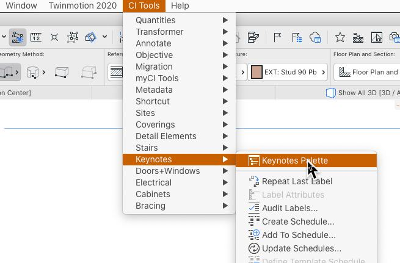

## 这套工具是什么

CI Tools 是 Central Innovation（新西兰）为 Archicad 开发的效率插件包，2026 年起被 Graphisoft 收进自有产品线并改名 **ProKit**。

同一套东西，两个名字。搜老教程用 "CI Tools"，搜新文档用 "ProKit"，内容对得上。

| | ProKit Core | ProKit Suite |
|---|---|---|
| 包含 | Annotate、Transformer、Time Tracker、Detail Elements | Cabinets、Coverings、Doors+Windows、Electrical、Fitout、Keynotes、MetaData、Quantities、Site、Stairs、Structure |
| 解决什么 | 出图提速、改图安全、计工时 | 建模提速、数据管理、算量出图 |
| 适用 | 所有项目 | 室内、电气、算量类项目 |

**免费试用**：任何工具都可申请 30 天试用
→ https://myci.centralinnovation.com/freetrial

## 先自查：你装了哪些

不同机器、不同 Archicad 版本，CI Tools 的安装情况不一样。开始用之前，先花一分钟确认自己这台机器的状态。

### 查插件装没装

看 Archicad 安装目录下的 Add-Ons 文件夹：

| 平台 | 路径 |
|---|---|
| Windows | `C:\Program Files\Graphisoft\Archicad XX\Add-Ons\CI Tools\` |
| macOS | `/Applications/Graphisoft/ARCHICAD XX/Add-Ons/CI Tools/` |

里面是 `CI Tools XXX.apx` 格式的插件文件。每个 `.apx` 对应一个工具（Annotate、Transformer、Keynotes……）。

### 查工作环境有没有

Archicad 菜单 **文件 → 工作环境**，列表里找 **Ci Tools Profile** 开头的条目。有这一项说明工作环境文件已就位。

### 三种常见状态

| 状态 | 判断依据 | 怎么办 |
|---|---|---|
| **全新安装** | Add-Ons 里没有 CI Tools 文件夹 | 装 CI Tools 或 ProKit 安装包 |
| **插件在但没加载** | 有 `.apx` 文件，但工具箱和菜单栏看不到入口 | 走下面「三步启动」，八成是缺工作环境或图库包 |
| **一切就绪** | 菜单栏有 CI Tools 菜单，工具箱有对应工具 | 直接用，遇到问题查第 5 章故障排查 |

> **版本差异提示**
> - **Archicad 24 及以上**支持 CI Tools
> - **Archicad 29 起**，库包（libpack）不再自动挂载，**必须手动加载**，这是"装了却用不了"的头号原因
> - **Archicad 30** 起工具包改名为 **ProKit**，安装包从 Graphisoft 官网下载，不再走 MyCi
> - 各版本包含的工具数量不同，缺失的工具需单独补装

## 每次新项目的三步启动

Archicad 启动后按顺序做完这三步，就能正常用所有工具。

### 第一步 · 加载工作环境

菜单 **文件 → 工作环境**，列表里找 **Ci Tools Profile**（版本号对应你的 Archicad，如 `Ci Tools Profile 28`）选中并应用。

找不到就点「浏览」，路径：

```
Windows: %APPDATA%\Graphisoft\Archicad XX.0.0 CHI R1\工作环境\配置文件\Ci Tools Profile XX.xml
macOS:   ~/Library/Preferences/Graphisoft/Archicad XX.0.0 CHI R1/工作环境/配置文件/Ci Tools Profile XX.xml
```

加载后左侧工具箱会出现 CI Tools 专属工具条。

### 第二步 · 加载图库包

**这是 90% 「装了却用不了」的原因。** 从 Archicad 29 起，CI Tools 的库包不再自动挂载，必须手动加载进项目。


菜单 **文件 → 库管理器（Library Manager）**，点「添加 / Add」，定位到：

```
C:\Program Files\Graphisoft\Archicad XX\Archicad 图库包\Ci Tools Library Packages\
```

**关键**：选中具体的 `.libpack` 文件（如 `Ci Tools Detail Elements.libpack`），**不要选文件夹层级** —— 选文件夹只会挂载一层，导致内容找不到。这是官方明确警告的坑。

**优先加载 `Ci Tools Macros.libpack`**，它承载各工具的自动化宏，很多功能依赖它。

### 第三步 · 把工具加进工具箱

有些插件装上了但工具箱里没图标：

1. 在左侧工具箱空白处**右键**
2. 选 **工具箱设置 / Toolbox Settings**
3. 勾选对应插件（如 ProKit Detail Elements、ProKit Electrical）
4. **保存工作环境** ← 不保存下次开 Archicad 又没了

## Annotate — 文字大小写批量转换

全项目文字格式统一。CAD 里从别处粘来的文字大小写乱成一片，手改能改到下班 —— 这是出图前最省时间的工具。

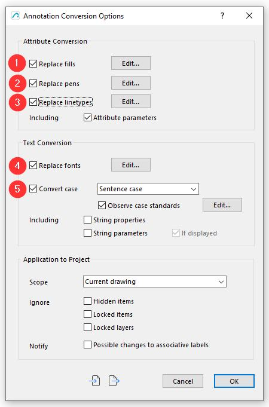


**入口**：CI Tools → Annotate → Convert Case…

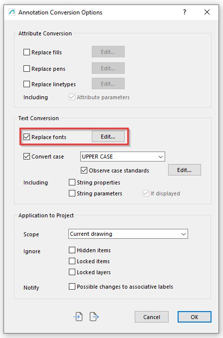

### 对话框三栏设置

**Case（格式）** — 选目标格式，并可勾选 Observe case exceptions 让某些词保持固定格式：

| 选项 | 效果 |
|---|---|
| Sentence case | 句首大写 |
| UPPER CASE | 全大写 |
| lower case | 全小写 |
| Title Case | 标题式大写 |

勾选 Observe case exceptions 后出现「编辑」按钮，可把 iPhone、BIM、m² 这类词锁定不变。

**Scope（范围）** — 决定改多少，防手滑的关键：

| 选项 | 作用范围 |
|---|---|
| Selected items only | 只改选中项（没选中时该选项变灰） |
| Text in the current drawing | 只改当前视图；平面图激活时即当前楼层 |
| Text in floor plan (all storeys) | 平面图全部楼层 |
| Text in all drawings | 全部图纸，含剖面、详图、图表 |

- 勾 **String properties** 同时转换字符串属性值（不影响下拉预设菜单选出的值，那种要用属性管理器改）
- 勾 **String parameters** 同时转换参数文字（锁定或隐藏的参数不会被改；选 "If displayed" 只转换与 2D 显示完全一致的参数值，**更安全，推荐**）

**Ignore（忽略）** — 勾选要跳过的项：

| 选项 | 跳过什么 |
|---|---|
| Hidden items | 隐藏图层上的全部 |
| Locked items | 被显式锁定的构件 |
| Locked layers | 锁定的图层 |
| Possible changes to associative labels | 可能引起关联标签变化的内容 |

**Notify（通知）** — 同在 Application to Project 区，勾选后会提示可能的关联标签变更。

点 OK 执行。

### 换字体与属性替换

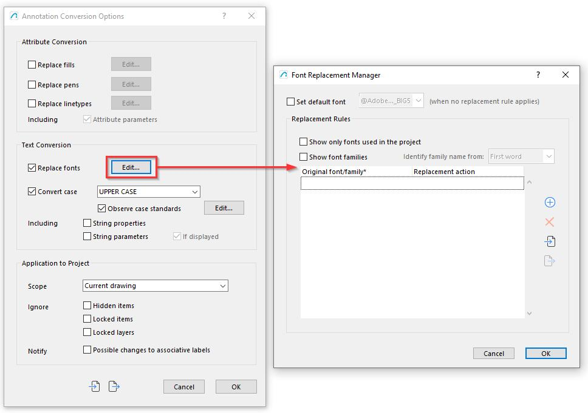

- **替换字体**：CI Tools → Annotate → Replace Fonts
- **批量替换属性值**：CI Tools → Annotate → Attribute Replacement
- **合并文本框**：把多个独立文本框合并成一个可编辑文本框

> **实战建议**：跑 Annotate 前先 Ctrl+Z 备份，或先用「Selected items only」试手。勾 "If displayed" 是最保险的选项。

## Transformer — 一键镜像整个项目

整个项目（含模型、标记、标签、2D 文字）沿轴线镜像。适合对称建筑、重复户型、批量复制改朝向。

手动旋转 3D 模型后，剖面、立面、标注、房间标签全得跟着改，极易漏 —— 这就是它的价值。

**入口**：CI Tools → Transformer → Mirror Project…

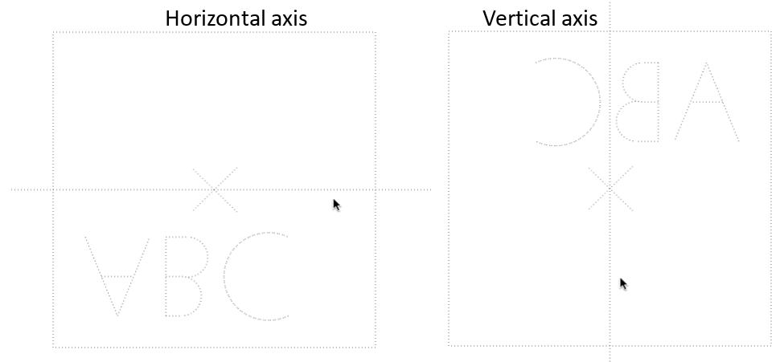

**操作**：

1. 点击镜像轴线的起点
2. 屏幕上出现预览线，随鼠标在**水平 / 垂直**之间自动切换（目前只支持这两种角度）
3. 方向满意 → 单击确认；想取消 → 按 ESC

> 破坏性操作，镜像后元素 ID 会变、原位置对象被替换。建议先另存一份再试。

## Time Tracker — 项目工时记录

记录在各个任务上花的时间，和报价、预期工时对比。**接活报价场景直接相关**。

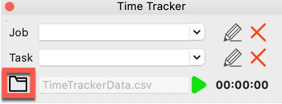


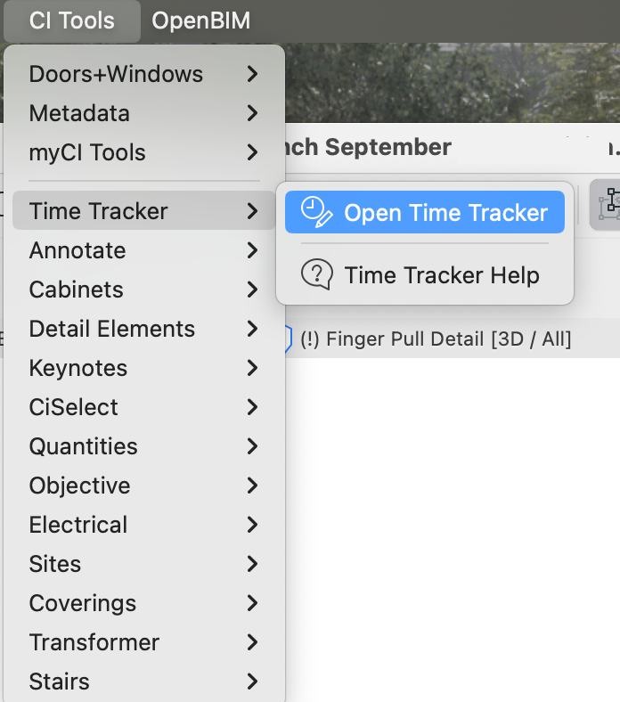

**入口**：CI Tools → Time Tracker → Open Time Tracker

三步：

1. 点文件夹图标，选择存档位置（时间数据存在你指定的文件里）
2. 指定 **Job（项目）** 和 **Task（任务）**
3. 启动计时

## Detail Elements — 智能二维详图构件库

拖拽式参数化 2D 详图对象库，大幅加速详图绘制（平面、剖面、立面、详图视图都能用）。


**10 个分类**：

| 分类 | 内容 |
|---|---|
| General Objects | 通用构件 |
| Floor Objects | 地面构件 |
| Wall Objects | 墙体构件 |
| Roof Objects | 屋面构件 |
| Ceiling Objects | 顶棚构件 |
| Door and Window Objects | 门窗构件 |
| Interior Trim Objects | 室内收边构件 |
| Fastening Objects | 连接件 |
| Reinforcing Objects | 加固件 |
| 2D Symbols | 二维符号 |

**前置**：手动加载 `Ci Tools Detail Elements.libpack`

**操作**：工具箱选中 ProKit Detail Elements 工具 → 设置面板里挑构件 → 在图纸上放置。对象是参数化的，双击可参数化编辑。

## Keynotes — 规范注释自动化

建立注释数据库，按构件属性**自动**挂注释到构件上，避免手工逐个标注的枯燥和错误。


**入口**：CI Tools → Keynotes → Keynotes Palette

**前置**：手动加载 `Ci Tools Keynotes.libpack`

**操作**：

1. 打开 Keynotes Palette，点 **A+** 添加 Keynote、编辑内容
2. **放置** Keynote：用 Archicad 的标签工具，但要选 **ProKit Label**
3. **双击** Palette 里的注释 → 在图纸上定位放置
4. 也可把 Keynote 关联到 Archicad 属性，自动标注

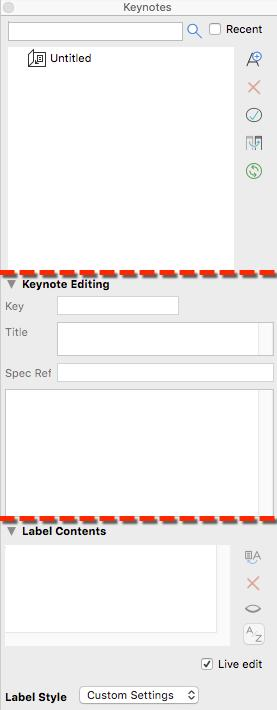

**两种用法**：直接在图纸上放完整注释；或只放参考键，由 Keynotes 自动汇总成明细表。

**进阶路径**：

- 属性关联：`Working with Attribute linked Keynotes`
- 主控明细表同步：`Using Master Schedules to define and sync Keynote Schedule Settings`
- 多页明细表：`Creating Multiple Page Keynote Schedules`
- **从其他项目导入已有数据库** —— 公司内部复用注释库的关键

## MetaData — 属性与分类批量操作

在一个面板里直接改构件属性和分类，不用在各种对话框里来回跳。**做 BIM 数据管理的主力工具**。

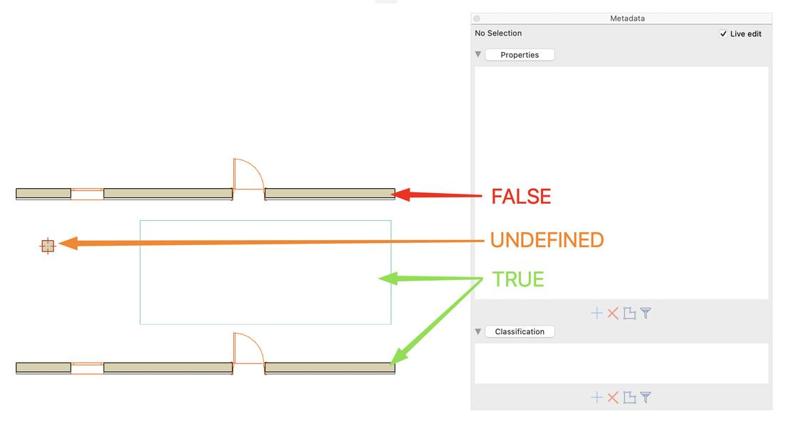


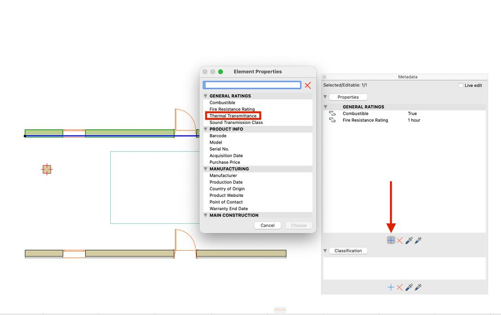

**核心能力**：

| 能力 | 说明 |
|---|---|
| 属性视图 | 在模型视图里直接看改属性，不用开属性管理器 |
| 批量改属性 | 一次改多个选中构件的属性 |
| 筛选与选择 | 按条件过滤出目标构件 |
| 属性传递 | 在构件之间复制、传递属性 |
| Traits 管理 | 给构件添加、移除、迁移自定义标记 |

**实战路径**：筛选定位 → 批量编辑 → 审计检查。

## Quantities — 工程量清单与算量

从实时模型出工程量清单，分配单价与数量，可导出 CSV 喂给其他造价软件。

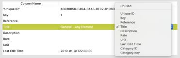


**入口**：CI Tools → Quantities

**工作流（官方 9 章结构）**：

| 章节 | 内容 |
|---|---|
| 1 Overview | 总览与术语 |
| 2 Project Data | 构件数据管理（数量 Traits） |
| 3 Bill of Quantities | 工程量清单结构 |
| 4 Defining Measurements | 测量配方 Recipe |
| 5 Generating Quantities | 生成工程量 |
| 6 Auditing | 审计核查 |
| 7 Element Calculation | 构件计算表达式 |
| 8 Calculation Functions | 计算函数 |
| 9 Calculation Operators | 计算运算符 |

**三个核心概念**：

- **Recipe（配方）** —— 用规则自动给构件分配数量成本，避免手工一个个填
- **Bill Structure（清单结构）** —— 分级目录（分类 → 条目），可嵌套
- **Traits** —— 挂在构件上的数量成本标记

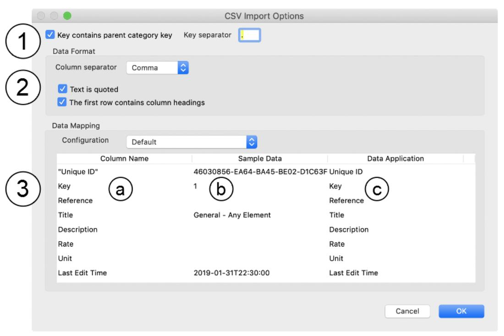

**审计是交付前必做**：

| 审计项 | 作用 |
|---|---|
| 6.2 审计构件数据 | 查数据是否填全 |
| 6.3 审计 Recipe 完成度 | 查配方有没有漏 |
| **6.4 审计漏算构件** | 查哪些构件根本没进清单 |
| 6.5 审计工程量清单 | 查清单本身对不对 |

> Quantities 是最容易「看着对其实错」的工具。交付前至少跑 6.4 和 6.5。

## Cabinets — 高度可配置的橱柜

**一个**高度可配置的对象搞定所有橱柜类型，不用为每种柜体单独建对象。

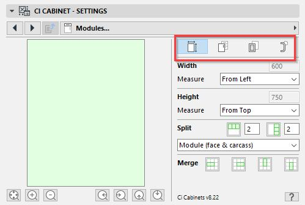


**能力**：平面和曲面柜门、抽屉面板库；可编辑面板样式与把手类型；自定义门、顶板、酒架、隔板、分隔件；隔板支持三维直接编辑。

## Coverings — 3D 覆面层

给墙、板、柱、屋顶贴 3D 建模的「皮」，2D/3D 视图都能显示，模型立刻有真实感。

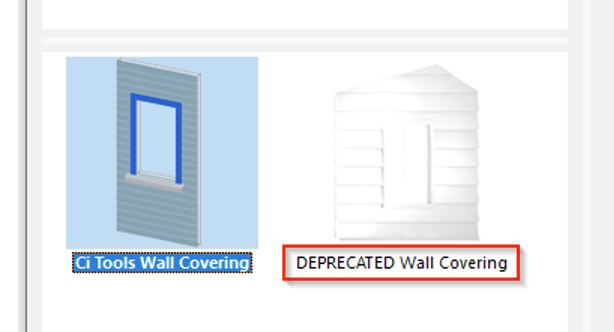


**关键机制**：

- 覆面**保持正确比例**，**自动链接到主体构件**，主体改了覆面跟着更新
- 预置覆面样式 + 支持自定义
- 屋顶覆面可**自动生成排水管**

> 出效果图和汇报模型时性价比很高 —— 比单纯改材质真实得多。

## Electrical — 智能电气符号与回路

**库覆盖区域**：欧盟、印度、撒哈拉以南非洲、英国、美国。**没有中国国标库**，国内项目需自建符号。

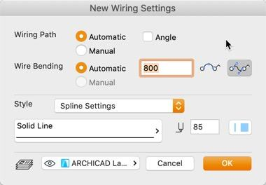


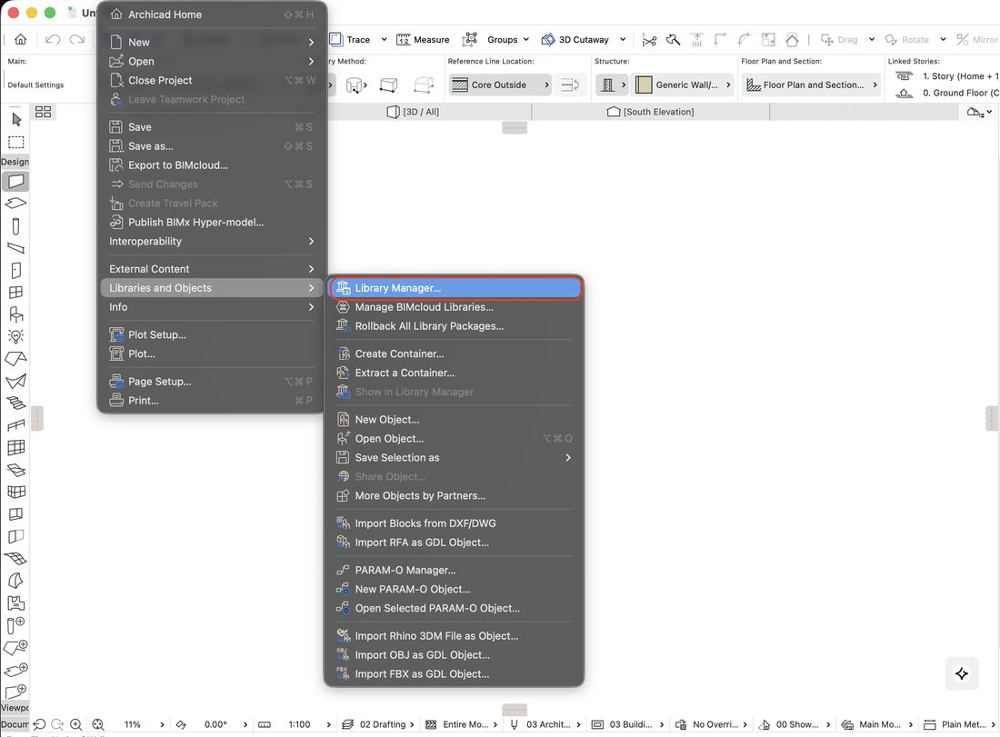

**前置**：手动加载 `Ci Tools Electrical.libpack`

**操作**：

1. 工具箱选中 ProKit Electrical 工具
2. 设置里挑符号（插座、开关、插孔、其他面板）
   - 设置**标高 Elevation** → 符号自动旋转并贴靠墙体
   - 符号既可显示为整个面板，也可拆成面板内的单个组件
3. **自动布电线**：选中构件 → 工具自动加走线
4. 设 Wire Style 走线样式 → 生成关联走线
5. 建回路、明细表

## Stairs — 灵活楼梯设计

直接在模型上自由设计楼梯。


**能力**：各类独立构件，住宅商业都能配；栏杆可关联楼梯、板甚至独立放置，能在不同宽度和高度处转折接平台；楼梯组合可当作单一对象编辑、标注、出图。

## Structural — 结构构件库

创建 3D 结构构件 —— 桁架、框架、连接件。


## Sites — 场地与景观（仅澳新）

可视评估模型与边界、退让高度的关系。**澳洲项目直接相关。**

**能力**：边界与高度退让平面；大型剪影式植物对象库；面积图章；边界绘制辅助；建筑包络工具。**早期方案阶段**评价场地关系最有用。

## Fitout — 一键布置房间

把空房间一键变成配齐家具的房间。**酒店客房、公寓户型快速布置神器。**

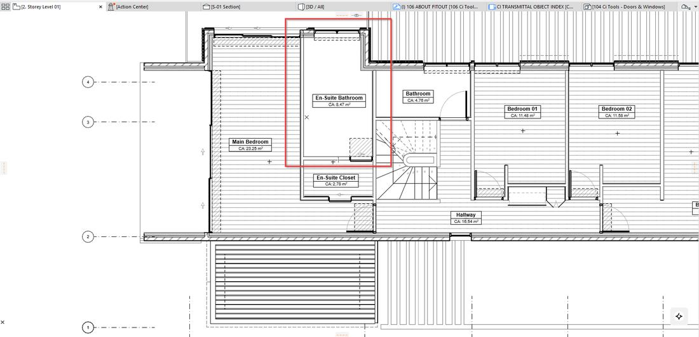


**前置**：加载 Ci Tools Profile 工作环境 + `Ci Tools Fitout.lcf` 图库

**操作**：

1. 编译 Sets（套组）和 Fitouts（布置），样例在 CI Tools Library → Fitout 文件夹
2. 在 Fitout 工具里选一个 Example Fitout（如 Bathroom 含浴缸、淋浴、马桶、洗手盆）
3. **在 Zone 里点击**放置
   - 工具对光标位置敏感，会优先把重点构件放在离点击点最近处
   - **可能要试放几次**才满意
   - 若 Zone 里没有窗扇净空，工具会自动补一个
4. 放置后是**成组**的 → `Alt+G` / `Cmd+G` 切换挂起分组，可单独移动某个物件，移动时自动吸附到靠着的墙

## Bracing — NZ 木结构支撑（仅新西兰）

新西兰木结构住宅的抗侧力构件计算与布置，符合 NZS 规范。国内和澳洲项目用不上。

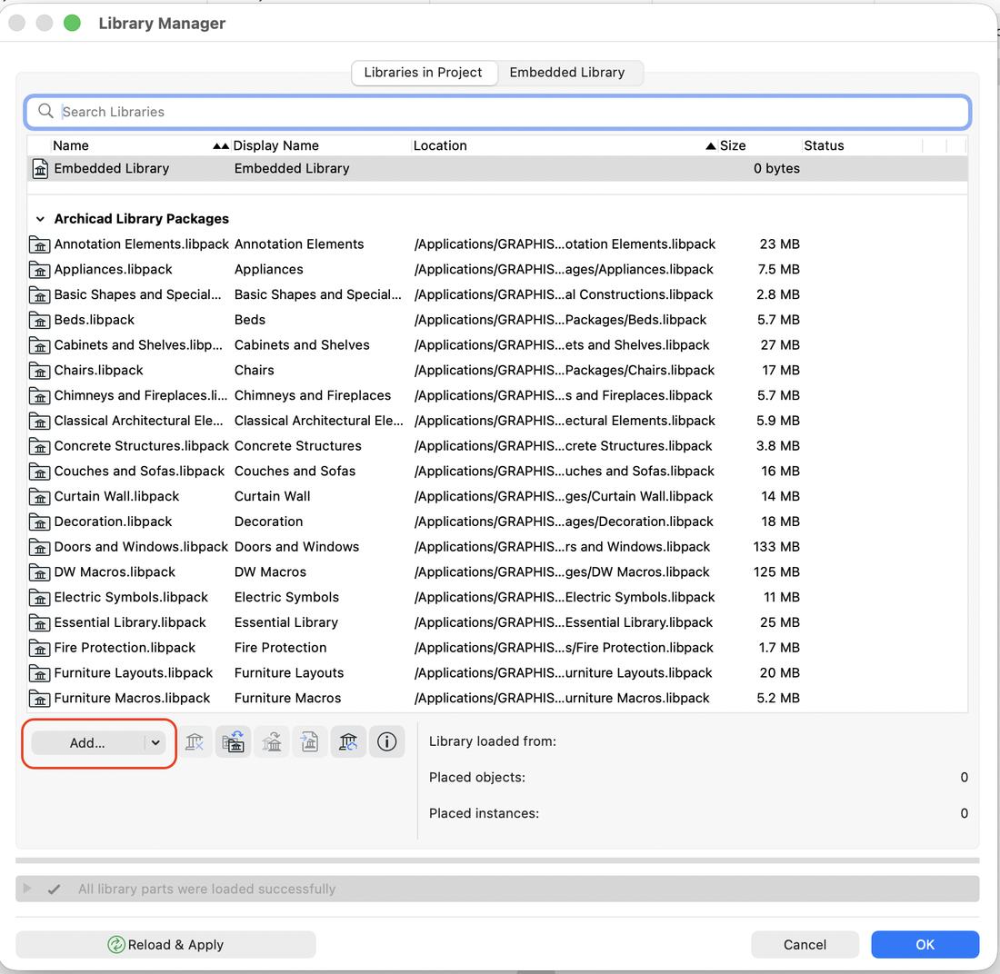


## 场景速查

| 你要做的事 | 用这个 | 入口 |
|---|---|---|
| 全项目文字大小写统一 | Annotate | CI Tools → Annotate → Convert Case… |
| 换字体、批量改属性文字 | Annotate | CI Tools → Annotate → Replace Fonts |
| 项目对称镜像 | Transformer | CI Tools → Transformer → Mirror Project… |
| 记录工时对报价 | Time Tracker | CI Tools → Time Tracker → Open Time Tracker |
| 快速出详图 | Detail Elements | 工具箱 → ProKit Detail Elements |
| 规范注释自动化 | Keynotes | CI Tools → Keynotes → Keynotes Palette |
| 批量改属性、分类 | MetaData | CI Tools → MetaData |
| 算量出清单 | Quantities | CI Tools → Quantities |
| 定制橱柜木作 | Cabinets | 工具箱 → ProKit Cabinets |
| 异形门窗 | Doors+Windows | 工具箱 → ProKit Doors+Windows |
| 模型贴皮提真实感 | Coverings | 工具箱 → ProKit Coverings |
| 电气点位与回路 | Electrical | 工具箱 → ProKit Electrical |
| 自由设计楼梯 | Stairs | 工具箱 → ProKit Stairs |
| 结构构件、桁架、框架 | Structural | 工具箱 → ProKit Structural |
| 场地边界与退让 | Sites | 工具箱 → ProKit Sites |
| 房间一键配家具 | Fitout | 工具箱 → ProKit Fitout |

## 故障排查

| 症状 | 原因 | 解决 |
|---|---|---|
| 菜单里没有 CI Tools | 工作环境没加载 | 文件 → 工作环境 → Ci Tools Profile 28 → 应用 |
| 工具箱里没有某个工具 | 插件已装但工具箱没加 | 右键工具箱 → 工具箱设置 → 勾选 → **保存工作环境** |
| 工具能开但没内容 | **libpack 没加载** | 文件 → 库管理器 → Add → 选**具体 .libpack 文件** |
| AC29/30 上内容为空 | AC29 起必须手动加载库包 | 同上 |
| 安装器里看不到 Archicad 版本 | 安装器检测不到 | 关闭 Archicad；点右上角 Find 手动指到安装目录；确认 Archicad 和安装器是同一 Windows 用户装的 |
| 图库加载了但对象不出现 | 选了文件夹层级 | 回库管理器，选单个 .libpack 重新加载 |
| 菜单全变英文、找不到某项 | 版本不一致 | AC28 用 CI Tools，AC30 用 ProKit |
| Detail Elements 拖不出对象 | Macros 没加载 | 优先加载 `Ci Tools Macros.libpack` |
| Annotate 改错了想回退 | 不可逆风险 | 执行前 Ctrl+Z；优先用「Selected items only」试手 |
| Transformer 镜像后元素丢失 | 破坏性操作 | 提前另存副本 |

## 上手建议

按优先级分三档，别一次学 16 个。

**第一优先 · 立刻见效**

1. **Annotate** — 出图前文字统一，10 分钟上手，省几小时
2. **MetaData** — 属性批量管理，BIM 交付必用
3. **Time Tracker** — 算工时对报价，直接对钱

**第二优先 · 项目需要时再学**

4. **Quantities** — 出算量清单
5. **Keynotes** — 规范注释系统（配数据库前期投入大）
6. **Transformer** — 偶尔镜像时用

**第三优先 · 特定场景**

7. **Coverings**（汇报模型提质感）、**Fitout**（客房批量布置）、**Sites**（澳洲场地）、**Detail Elements**（详图库）

**暂不建议碰**：Cabinets、Doors+Windows、Electrical（无国标库）、Structural、Bracing（NZ 专用）

## 官方资源

| 资源 | 地址 |
|---|---|
| MyCi 知识库（最全） | https://cadimage.zendesk.com/hc/en-us |
| ProKit 官方下载 | https://www.graphisoft.com/en-gs/downloads/prokit |
| 免费试用申请 | https://myci.centralinnovation.com/freetrial |
| Graphisoft Learn 视频课 | https://learn.graphisoft.com/visitor_catalog_class/show/131995 |
| 官方社区 | https://centralinnovation.com/software/ci-tools |

**最快入门路径**：Graphisoft Learn 上 1 小时视频课 "Getting Started with ProKit Core"，覆盖 Annotate / Detail Elements / Time Tracker / Transformer 四个工具，英文带字幕。

## 附录 A · 安装与补装

### 首次安装 CI Tools（Archicad 24 ~ 29）

1. 前往 MyCi 知识库下载 CI Tools Installer
   → https://cadimage.zendesk.com/hc/en-us
2. 关闭 Archicad，运行安装器，用 **MyCi 账号**登录（注意：不是 Graphisoft ID）
3. 选择 **Install Ci Tools**，指定目标 Archicad 版本
4. 列表里勾选需要的工具 → Install
5. 重启 Archicad，**加载工作环境 + 加载图库包**（见第 2 章三步启动）

> 若安装器里看不到你的 Archicad 版本：关闭 Archicad，点安装器右上角 **Find** 手动指到安装目录；确认 Archicad 和安装器是同一个系统用户装的。

### 安装 ProKit（Archicad 30）

2026 起 CI Tools 更名为 ProKit，改为 Graphisoft 官方产品，**无需 MyCi 账号**：

- ProKit Core（Annotate、Transformer、Time Tracker、Detail Elements）
  → https://www.graphisoft.com/downloads/add-ons/prokit/#Archicad-prokitcore
- ProKit Suite（Cabinets、Coverings、Doors+Windows、Electrical、Fitout、Keynotes、MetaData、Quantities、Site、Stairs、Structure）
  → https://www.graphisoft.com/downloads/add-ons/prokit/#Archicad-prokitsuite

### 补装缺失的单个工具

不同版本随附的工具不同。若发现某个工具没有：

- **Archicad 24~29**：在 CI Tools Installer 里勾选该工具单独安装，安装后重新加载工作环境与图库包
- **Archicad 30**：ProKit Core 与 Suite 是两个独立安装包，缺哪个装哪个

### 版本与功能对照

| 版本 | 工具包名称 | 获取方式 | 注意 |
|---|---|---|---|
| 24 ~ 29 | CI Tools | MyCi Installer | 库包需手动加载 |
| 30 及以后 | ProKit Core / Suite | Graphisoft 官网 | 菜单名改为 ProKit |

**区域限制**：Electrical 库含欧盟、印度、撒哈拉以南非洲、英国、美国，**无中国国标库**；Sites 与 Bracing 为澳新 / 新西兰专属。

## 附录 B · libpack 全量加载顺序

路径：`C:\Program Files\Graphisoft\Archicad XX\Archicad 图库包\Ci Tools Library Packages\`

```
1.  Ci Tools Macros.libpack          ← 先加载这个
2.  Ci Tools Detail Elements.libpack
3.  Ci Tools Electrical.libpack
4.  Ci Tools Keynotes.libpack
5.  Ci Tools Cabinets.libpack
6.  Ci Tools Coverings.libpack
7.  Ci Tools Doors+Windows.libpack
8.  Ci Tools Fitout.libpack
9.  Ci Tools Stairs.libpack
10. Ci Tools Structural.libpack
11. Ci Tools Sites.libpack
12. Ci Tools Bracing.libpack
13. Ci Tools Time Tracker.libpack
```

---

*本手册基于官方 MyCi 知识库（2026-10 更新）编写，界面截图取自官方教程文档，适用于 Archicad 24 及以上版本。各机器安装情况不同，请先按第 1 章自查。*
